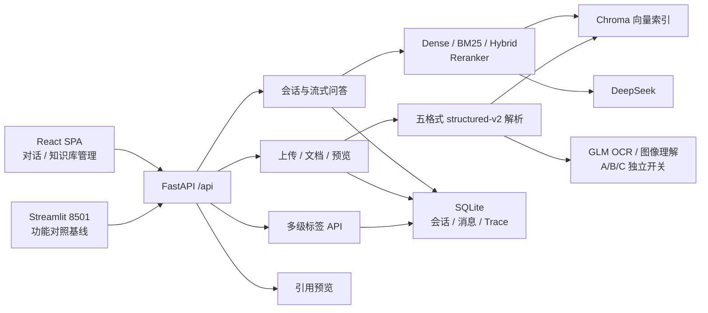

# 阶段 3 React 前端重新规划（已确认，F4 已完成）

> 状态：**F0-F4 已于 2026-08-15 完成；阶段 3 工程验收通过，等待用户确认最终功能对齐；Streamlit 未删除**
> 日期：2026-08-15
> 适用分支：`feature/rag-v2-optimization`，当前 HEAD `47aca19`
> 实施门槛：已满足；仍须按 F0→F4 阶段边界逐段验收，不得跨阶段静默推进。
> 本文只规划前端与必要测试，不授权修改生产数据、`.env`、后端检索算法或删除 Streamlit。

用户已确认的补充决策（2026-08-15）：

- 聊天检索范围选择器只放在**对话页内部**，不进入全局顶栏；知识库页的文档标签筛选是另一个独立功能，两者不共享临时选择状态。
- 原则同意引入 Playwright 浏览器自动化；规划完全确认前不安装，实际安装前先说明版本、位置、影响、磁盘占用和卸载方式。
- 知识库页面采用本文件 7.3 节的**方案 A**：文档列表占满主工作区，上传和标签管理通过右侧操作面板按需打开。

## 1. 重新规划原因与当前结论

本轮不能继续按“视觉润色”处理，必须回到阶段 3 的**功能对齐验收**。

已确认事实：

1. 用户截图中的知识库页面存在严重叠层：上传 Dragger 越过上传卡片底部，覆盖标签管理区的输入框、按钮和列表。
2. Sol 在 1920×1080、Windows 150% 显示缩放环境复现：
   - 上传卡片底部约 `714.8px`；
   - Dragger 底部约 `824.3px`，越界约 `109.5px`；
   - 标签卡片顶部约 `730.8px`，因此 Dragger 与标签卡片重叠约 `93.5px`。
3. 根因不是数据量，而是 Ant Design Dragger 内层的 `height: 100%` 在自动高度卡片中按卡片内容区计算；Dragger 又排在标题和说明之后，最终必然越过父卡片。当前 CSS 只设置边框和背景，没有覆盖这个高度规则。
4. 聊天标签筛选**没有从代码或当前运行页面中实际删除**：
   - `ChatPage` 仍维护 `tagFilter`；
   - 发送请求仍传递 `tags: tagFilter`；
   - 运行页面可展开标签树、选择 `pit`，并显示“筛选：pit”。
5. 但用户认为它已经消失，说明其视觉层级、位置和状态表达不合格。标签筛选是本项目缓解全库漏召回的核心入口，不能只满足“DOM 中存在”。
6. 上一轮验收只检查整体横向滚动和静态截图，没有检查组件是否越出父容器、相邻区域是否重叠、不同 Windows 缩放下是否稳定，验收方法不足。
7. 当前 React 前端尚未达到原阶段 3 功能对齐要求，不能宣布前端阶段验收完成。

## 2. 审计范围与事实来源

本规划由 Sol 主代理直接审计，未将项目理解交给子代理。

主要事实来源，按优先级排序：

1. 当前后端代码、React/Streamlit 代码与测试；
2. `docs/superpowers/specs/2026-08-13-rag-v2-optimization-design.md`；
3. 阶段 1/2/3 实施计划；
4. `docs/测试反馈记录.md`；
5. README 和旧交接文档，仅用于历史背景，不作为当前状态的唯一依据。

仓库中没有单独的 `AGENTS.md` 文件；当前会话注入的项目工作规则继续有效。

### 2.1 已发现的文档漂移

- `README.md:13`、`README.md:30-52` 仍以 `structured-v1 + Streamlit` 描述当前主架构；实际解析版本已经是 `structured-v2`，React SPA 已由 FastAPI 托管。
- `README.md:88` 仍称不支持扫描 PDF OCR，与阶段 2 当前实现冲突。
- 阶段 3 计划 `2.2` 写的是 React 18 / AntD 5；实际 `web/package.json` 已锁定 React 19 / AntD 6，整体设计文档已补充实际版本。
- `docs/测试反馈记录.md:176-180` 将布局反馈 #21 标记为“已修复”，但用户截图和 150% 缩放复现已经推翻该结论。规划确认并实施后应先把 #21 改为“回归待修复”，验收通过后再关闭。
- 阶段 3 的门槛要求“功能对齐后移除 Streamlit”，当前 `frontend/` 仍保留，因此阶段 3 尚未完成最终验收。

## 3. 当前项目整体架构



部署关系：

- 开发模式：Vite 代理 `/api` 到 `127.0.0.1:8000`。
- 当前验收模式：FastAPI 在 8000 静态托管 `web/dist`。
- 8501 Streamlit 是功能对照基线，只有 React 完整对齐后才能移除。
- 当前定位仍是本地单用户系统，不包含认证、多租户或权限。

## 4. 前端必须完整承载的业务能力

| 领域 | 必须呈现的能力 | 后端契约与不可回归规则 |
|---|---|---|
| 后端状态 | 启动检查、离线提示 | `GET /api/health`；健康提示不能遮挡页面主操作 |
| 会话 | 新建、切换、自动标题、重命名、删除确认、刷新恢复 | `/api/conversations` CRUD；列表按更新时间倒序 |
| 标签检索范围 | 多选树、父级含子孙、多选取并集、空选择=全库、当前筛选状态、一键清除 | `ChatRequest.tags`；标签不写入会话历史，只作用于本次检索 |
| 持久化问答 | `request_id` 幂等、`expected_last_message_id` 并发守卫 | 404 会话不存在；409 包括 `conversation_conflict`、`request_in_progress`、`stale_retry` 等 |
| 流式回答 | meta→delta*→citations→done；停止生成；失败消息重试 | 停止采用语义甲：按失败处理，不保存半截助手回答，可显式重试 |
| 空检索 | 全库空结果和标签筛选空结果使用不同提示 | 选择标签时应引导调整/清除标签；不能统一成模糊“无结果” |
| 引用 | 来源列表、已删除来源提示、结构化预览、目标高亮 | 引用预览 404 表示历史来源已删除；不得泄漏文件系统路径 |
| OCR 展示 | OCR 文本显示“AI 识别，可能存在误差” | `LocatedBlock.attributes.ocr === true`；OCR 失败 warning 不阻塞整份文档入库 |
| Trace | 阶段、候选、完整 chunk、最终上下文、各阶段耗时、其他阶段说明 | Trace 可跨会话/刷新/重启恢复；为 null 或被 LRU 淘汰时不显示入口 |
| 上传 | 选择仅暂存、移除不请求、确认后上传、多文件、带标签、新建标签自动选中、进度、失败保留与重试 | `POST /api/upload`；单文件最大 50MB；解析/OCR warning 必须逐文件展示 |
| 标签管理 | 新建空标签、自动补父级、真实树形展示、双层计数、重命名子树、删除确认 | 最大 6 层、总长 200；删除标签只解除关联，文档保留 |
| 文档管理 | 列表字段、服务端标签筛选、刷新、编辑标签、删除确认、整文档预览 | 文档筛选与聊天筛选复用同一父子展开/并集语义 |
| 启动与托管 | 8000 可直接加载 SPA、前端路由刷新可回退、JS MIME 正确 | 不改变现有 `/api` 路径；不破坏启动/停止脚本 |

## 5. 当前 React 实现的审计结果

### 5.1 已存在且应保留

- 会话 CRUD、流式请求、停止、失败重试和 409 自动重同步代码已经存在。
- 标签树选择组件、聊天请求 `tags` 载荷和选中标签徽标已经存在。
- 引用预览、已删除来源提示、结构化内容渲染、OCR 徽标已经存在。
- Trace 持久化数据可由历史消息恢复，抽屉包含“其他阶段”耗时说明。
- 知识库已有上传、上传标签、新建标签、标签 CRUD、文档筛选、文档预览、文档改标签和删除入口。

“已有入口”不等于完成验收，下一节列出真实缺口。

### 5.2 P0：必须先解决的严重回归

1. **知识库组件叠层**：Dragger 越界覆盖标签区，150% 缩放稳定复现。
2. **聊天标签筛选可发现性失败**：技术上存在并可选择，但用户无法明确识别，必须重新设计为聊天主路径的一部分。
3. **错误的验收结论**：反馈 #21 与上一轮交付说明需要在重新验收后更正，不能沿用“已完成”。

### 5.3 P1：阶段 3 功能对齐缺口

1. `KnowledgePage.confirmUpload()` 完成后无条件 `setStagedFiles([])`；失败文件不会保留，无法原地重试，违反已确认的上传三段式要求。
2. 当前上传只有整批 `loading`，没有逐文件状态或进度表达。
3. 当前 React 上传前没有明确的后端就绪检查和“暂存未提交”保护提示。
4. 标签管理虽然使用路径排序，但主列表仍是扁平列表，不是真正的父子树管理视图。
5. 当前上传区、标签区和文档表同时永久展开，造成主次混乱；当内容增长时多个滚动容器互相竞争。
6. 页面状态和异步逻辑都集中在两个大型 Page 组件中，布局调整容易误伤业务状态。

### 5.4 P1：测试缺口

当前 React 自动化只有 3 个文件、8 个测试：

- 标签路径组树算法；
- NDJSON 单行解析；
- 应用顶栏/路由壳。

尚未自动覆盖：

- 标签选择后请求载荷是否真的包含 `tags`；
- 一键清除后是否恢复空列表=全库；
- 父标签、多标签状态与用户可见提示；
- 409 重同步、停止生成、失败重试；
- 上传“选择不提交、确认才提交、失败保留、只重试失败项”；
- 上传标签新建后自动选中；
- OCR warnings 展示；
- 标签重命名/删除确认；
- 文档筛选/预览/改标签/删除；
- CSS 越界、组件重叠、Windows 125%/150% 缩放和移动端断点。

因此“8/8 通过”只能证明少量工具逻辑与应用壳，没有证明页面功能完整。

## 6. 重新设计原则

1. **标签检索范围是聊天核心功能**：始终可见、状态明确，不放进“更多”菜单，不仅依赖 placeholder。
2. **知识库以文档为主**：文档表/列表是默认主工作区；上传和标签管理是明确触发的任务，不永久占用一整列。
3. **业务流程先于装饰**：先锁定上传、筛选、重试、409、Trace 等状态机，再做视觉层。
4. **内容卡片不使用互相依赖的百分比高度**：只有消息时间线、长列表等明确区域拥有滚动权。
5. **一个区域一个滚动所有者**：页面滚动、消息滚动、抽屉内容滚动边界必须明确。
6. **响应式不仅检查横向滚动**：同时检查父子边界、相邻区域、浮层、下拉框、表格和按钮是否重叠。
7. **保留现有 API**：本轮布局与前端状态重构原则上不需要新增后端接口或修改 schema。
8. **Streamlit 继续保留**：只有完整功能对齐及用户手动验收后才讨论移除。

## 7. 推荐页面方案

### 7.1 全局应用壳

- 保留紧凑顶部导航，但高度以 56–64px 为上限。
- 左侧：产品名称；中间：对话 / 知识库；右侧：后端状态。
- 后端离线时使用顶栏下方的紧凑提示，不改变页面关键容器高度计算。
- 内容区使用统一最大宽度/边距 token，不允许页面再叠加一层重复大 padding。

### 7.2 对话页：会话与检索范围并列为一级能力

桌面推荐结构：

```text
┌─ 顶部导航 ──────────────────────────────────────────────────────┐
├──────────────┬──────────────────────────────────────────────────┤
│ 会话  13     │ 当前会话标题                         [更多操作] │
│ [+ 新建]     ├──────────────────────────────────────────────────┤
│              │ 检索范围  [全部知识库 / 标签多选树 ▼] [清除]   │
│ 会话列表     │ 当前状态：全库；或 已选 pit、计网（多标签并集） │
│              ├──────────────────────────────────────────────────┤
│              │                                                  │
│              │ 消息时间线 / 引用 / Trace                        │
│              │                                                  │
│              ├──────────────────────────────────────────────────┤
│              │ 输入问题……                              [发送] │
└──────────────┴──────────────────────────────────────────────────┘
```

具体约束：

- 会话栏桌面宽度约 256–280px；聊天主区 `minmax(0, 1fr)`。
- “检索范围”独立成一条固定、可读的作用域栏，不与普通筛选器混在一起。
- 空选择必须显示“全部知识库”；选中后展示标签 chips、文档范围说明和一键清除。
- 明示“父级包含子标签，多标签取并集；范围用于下一次提问”。
- 在聊天页内切换会话时保留当前筛选；刷新或离开页面后的持久化暂不扩大范围，维持现有行为。
- 发送请求的唯一事实来源仍是当前 `tagFilter`；重试时也必须在 UI 中明确显示当前生效范围。
- 窄屏下会话列表进入 Drawer；检索范围栏仍保留在聊天主区顶部，不能一起藏入 Drawer。

### 7.3 知识库页：文档主工作区 + 按需操作面板（方案 A，已确认）

这里的“右侧操作面板”指：点击按钮后，一个面板从页面右边滑出来；操作完成关闭它，回到完整文档列表。它不是新的页面，也不会跳走。

平时看到：

```text
┌─ 知识文档 ───────────────────────── [标签管理] [上传文档] ──┐
│ 文档标签筛选 [全部标签 ▼]                         [刷新] │
├───────────────────────────────────────────────────────────┤
│ 文档名称 │ 标签 │ 大小 │ chunks │ 上传时间 │ 操作          │
│ scan.pdf │ pit  │ ...  │ ...    │ ...      │ 预览/标签/删除│
│ ...                                                       │
└───────────────────────────────────────────────────────────┘
```

点击“上传文档”后：

```text
原文档列表仍在页面后方       ┌─ 上传文档操作面板 ─────────┐
                            │ ① 选择文件                 │
                            │ ② 查看/移除暂存文件        │
                            │ ③ 选择或新建标签           │
                            │ ④ 确认上传                 │
                            │ ⑤ 查看成功/失败/OCR 警告   │
                            │    失败文件保留，可重试     │
                            └────────────────────────────┘
```

点击“标签管理”时，同一个位置显示标签树、新建、重命名和删除；不会再把上传区、标签区和文档表三块内容长期挤在一起。

该方案的已确认取舍：文档表获得最大空间，上传流程和错误信息在独立面板内完整呈现；上传或管理标签时需要先点击一次入口按钮。上传流程必须保留：选择只暂存、确认才上传、逐文件状态、失败保留并重试、OCR warning 展示。

右侧操作面板规则：

- “上传文档”和“标签管理”共用同一右侧面板容器，同一时间只承载一种任务；
- 打开面板不离开知识库页面，关闭后保留文档筛选、分页和滚动位置；
- 上传进行中不得因误触遮罩或切换任务而静默丢失暂存队列；
- 桌面端使用右侧抽屉，窄屏改为全宽抽屉，不在页面下方追加永久操作区；
- 文档列表仍是页面滚动主体，抽屉内容拥有独立纵向滚动，不互相争夺滚动权。

### 7.4 弹窗与抽屉边界

- 引用预览：保持弹窗或大抽屉，必须滚动到目标高亮。
- 整文档预览：推荐大抽屉，保持 unit 顺序和位置标签，无高亮浏览模式。
- 文档标签编辑：小型弹窗，保存后同步刷新文档和标签计数。
- Trace：保留抽屉；小屏宽度使用 `min(860px, 100vw)`，避免固定 860px 溢出。

## 8. 组件与状态拆分规划

建议目标结构（最终文件名可在实施前微调）：

```text
web/src/
  app/
    AppShell.tsx
  pages/chat/
    ChatPage.tsx
    ConversationRail.tsx
    RetrievalScopeBar.tsx
    MessageTimeline.tsx
    ChatComposer.tsx
    useChatController.ts
  pages/knowledge/
    KnowledgePage.tsx
    DocumentTable.tsx
    UploadWorkflowDrawer.tsx
    TagManagerDrawer.tsx
    DocumentTagsModal.tsx
    DocumentPreviewDrawer.tsx
    useUploadQueue.ts
  components/tags/
    TagTreePicker.tsx
    TagScopeSummary.tsx
```

约束：

- Page 负责装配，API/异步状态进入 controller/hook，展示组件不直接复制业务请求逻辑。
- 上传队列使用显式状态：`staged / uploading / success / failed`；成功项移除或归档，失败项保留。
- 不因为已安装 Zustand 就强制引入全局 store；跨页面共享需求未确认前，优先页面级 reducer/hook。
- 标签树只保留一个构建实现，聊天、上传、文档筛选和标签管理共用。
- CSS 使用页面作用域和统一 token；避免在全局 CSS 中覆盖全部 AntD 组件。
- 对 AntD Dragger 显式设定内容高度或 `height: auto`，父卡片不得依赖子元素百分比高度。

## 9. 实施阶段与暂停点

用户确认本规划后，按以下阶段执行；每一阶段完成后由 Sol 停止并报告证据。

### F0：基线和回归测试先行

- 把反馈 #21 改为“回归待修复”。
- 记录当前 UI 工作区差异，不触碰此前启动脚本、MIME 修复和用户 `.claude/`。
- 为标签筛选、上传队列和知识库关键交互补失败测试。
- 未形成失败测试前不重构页面。

F0 执行结果（2026-08-15）：

- 已建立独立基线记录：`docs/superpowers/baselines/2026-08-15-phase-3-frontend-f0-baseline.md`；
- 反馈 #21 已从错误的“已修复”更正为“回归待修复”；
- 新增 6 个页面行为测试，其中 4 个保护现有请求契约并通过；
- 形成 2 个稳定的预期失败：聊天空筛选未明确显示“全部知识库”、上传失败后没有保留/重试入口；
- 全量结果为 14 个测试中 12 通过、2 个预期失败；lint 与生产构建通过；
- 未修改页面生产代码，未安装 Playwright，未进入 F1。

### F1：应用壳与聊天页

- Sol 亲自处理核心信息架构和 `RetrievalScopeBar`。
- 保持会话、流式、409、停止、重试、引用和 Trace 协议不变。
- 完成桌面/窄屏浏览器验收并暂停。

F1 执行结果（2026-08-15）：

- 应用壳拆分为 `app/AppShell.tsx`，保持紧凑顶部导航和后端状态；小屏仍保持单行导航，不再扩展成占高两行；
- 聊天页拆分为业务控制器、会话栏、检索范围栏、消息时间线和输入区，Page 只负责装配与弹层状态；
- 空标签范围始终明确显示“全部知识库”；选中标签后显示数量、标签 chips、父子/并集语义和一键清除，仍以 `tagFilter` 作为聊天请求唯一来源；
- 会话栏桌面固定约 272px，820px 以下进入 320px 左侧抽屉；检索范围始终留在聊天主区；
- 当前会话 ID 写入会话级浏览器存储，刷新后恢复；异步会话加载增加序列守卫，避免晚返回请求覆盖较新的选择；
- 新增并通过 409 只重同步不重放、停止生成中止请求、失败消息复用 `request_id` 重试等回归测试；
- F1 定向测试 8/8 通过；全量 17 个测试中 16 通过，只保留 F2 的上传失败保留/重试 RED 测试；lint 与生产构建通过；
- FastAPI 8000 真实浏览器覆盖 1920×1080、1440×900、1280×720（1920×1080@150% 等效 CSS 视口）、1024×768、768×1024、390×844；所有视口无整页横向溢出，检索范围和输入区位于主容器内；
- 真实浏览器完成标签选择/清除、窄屏会话抽屉和刷新恢复当前会话验证，控制台无 error；未安装 Playwright，未进入 F2。

### F2：知识库文档主工作区

- 文档表成为默认主区域。
- 实现上传工作流抽屉、标签管理抽屉和预览边界。
- 修复失败文件保留/重试、逐文件状态、OCR warning 展示。
- 完成知识库功能对齐并暂停。

F2 执行结果（2026-08-15）：

- 知识库默认界面改为全宽文档主工作区，上传文档与标签管理只在点击后进入同一位置、同一宽度的右侧任务抽屉，不再永久挤占文档列表；
- 原巨型 `KnowledgePage` 已拆分为文档表、上传工作流、标签管理、文档标签弹窗、文档预览抽屉和上传队列 hook，页面组件只负责装配与跨模块状态协调；
- 上传队列采用 `staged / uploading / success / failed` 显式状态，选择文件不请求后端，确认后逐文件提交；成功项保留结果，失败项保留并且重试只提交失败文件；
- 上传前限制 PDF、DOCX、TXT、Markdown、PPTX 和单文件 50 MB；上传标签支持保留旧选择并自动加入新标签；OCR warning 使用“AI 识别，可能存在误差”明确提示；
- 标签管理按父子路径真实呈现树形层级和“本层/含子级”计数，重命名或删除后同步修正文档筛选与上传标签状态；文档预览改为大抽屉，保留单元顺序、位置和 OCR 徽标；
- 文档筛选增加请求序列守卫，快速切换时旧响应不能覆盖新结果；预览请求也增加关闭/切换守卫；
- F2 定向测试 10/10 通过；全量前端测试 24/24 通过；lint、TypeScript 与生产构建通过（仅保留既有的大 chunk 体积警告）；
- FastAPI 8000 真实浏览器在 1280×720 完成文档工作区、上传抽屉、标签抽屉、整文档预览和 `pit` 服务端筛选的只读验证；页面无横向溢出，抽屉独立滚动，控制台无 error/warning；
- 浏览器边界测量曾发现 AntD Dragger 外层为 inline，视觉高度未计入父卡片而再次越界；已改为 block/100% 宽度并复测三个上传步骤的所有直属子元素均位于父卡片内。多尺寸与 Windows 125%/150% 完整矩阵留在 F3。

### F3：跨页面集成与响应式

- 统一标签组件与视觉 token。
- 覆盖 Windows 100%/125%/150% 缩放与多尺寸视口。
- 检查弹窗、抽屉、下拉树、表格和滚动所有权。

F3 执行结果（2026-08-15）：

- 聊天检索范围、知识库文档筛选、批量上传和文档标签编辑统一使用 `TagTreeSelect`；补充业务可辨识名称、搜索、响应式折叠和统一宽度入口，但聊天与知识库仍保持独立的临时选择状态；
- 全局视觉颜色、边框、圆角和阴影收敛为 CSS token；聊天多标签区限定自身纵向滚动，长标签不会继续挤压消息时间线；
- 知识库在 992px 以下由固定操作列的表格切换为文档卡片，文档名、大小、片段、标签、上传时间及三个操作均完整可达；桌面表格保留固定操作列，窄至 1024px 时只允许表格内部横向滚动；
- 会话抽屉改用根级样式约束；上传、标签管理、文档标签编辑和预览在 390px 宽度下均不推动整页，标签树缩进设上限；
- 检索详情不再把耗时文字塞入进度条格式区；390px 抽屉主体宽度与滚动宽度均为 390px，展开候选明细后 900px 表格只在自身 293px 可视区内横向滚动，抽屉主体未产生横向滚动；
- FastAPI 8000 真实浏览器覆盖 1920×1080、1536×864（1920×1080@125% 等效）、1280×720（1920×1080@150% 等效）、1024×768、768×1024、390×844；聊天与知识库所有视口均满足页面 `scrollWidth == clientWidth`；
- 390px 下实际检查了上传三步骤、标签下拉、标签树、文档标签弹窗、文档预览、会话抽屉、五标签检索范围和检索详情；未对生产数据执行上传、重命名或删除；
- 新增共享标签选择器、窄屏文档卡片和检索详情结构回归；全量前端 7 个测试文件、27/27 测试通过，lint、TypeScript 与生产构建通过；仅保留既有的单个 JavaScript chunk 超过 500 kB 警告；
- 本阶段未安装 Playwright，使用应用内真实浏览器完成只读尺寸与边界验证；未进入 F4 的最终后端回归、README/阶段总状态收口和用户功能对齐确认。

### F4：最终验收与文档

- 运行前端单测、lint、TypeScript、生产构建和后端相关回归。
- 通过 FastAPI 8000 做真实浏览器功能验收。
- 更新 README 架构、阶段 3 状态和测试反馈。
- 只有用户确认功能对齐后，才另行讨论删除 Streamlit；本计划不自动删除。

F4 执行结果（2026-08-15）：

- 前端重新运行全量 Vitest、oxlint、TypeScript 和 Vite 生产构建：7 个测试文件、
  27/27 测试通过，lint 与构建通过；仅保留单个 JavaScript chunk 超过 500 kB 的
  既有体积警告；
- 后端不依赖本地模型且不调用外部 API 的回归为 423/423 通过；本地
  Embedding/Reranker 隔离集成测试为 38/38 通过；3 项 external DeepSeek 测试未调用，
  未产生外部请求或费用；最终完整 pytest 复验为 461 passed、3 skipped；
- FastAPI 8000 最终真实浏览器验收确认 SPA 正常挂载、后端在线且控制台无 error；
  聊天页实际选择 `pit` 后显示“已选 1 个标签”，历史 Trace 可打开并展示 5 行耗时和
  3 个候选阶段；
- 知识库 `pit` 服务端筛选实际由 31 份文档收敛为 `scanword.pdf`、`scan.pdf`、
  `111.docx` 三份；`scanword.pdf` 结构化预览返回 2 个内容单元并显示 OCR 风险徽标；
  上传与标签管理抽屉只读打开成功，未执行上传、新建、重命名或删除；
- 390×844 最终复验确认检索范围、输入区、320px 会话抽屉和 10 张文档卡片均位于
  页面宽度内；知识库在窄屏不再渲染固定操作列表格，每张卡片保留 3 个文档操作；
- README 已更新为 React SPA 主前端、`structured-v2`、可选 OCR、标签/Trace 持久化和
  当前启动测试方式；原阶段 3 计划与反馈 #21 已同步实际结果；
- 未改生产数据、`.env` 或后端检索算法，未安装 Playwright，未提交或推送；旧
  Streamlit 仍作为兼容对照保留，是否删除等待用户另行确认。

## 10. 自动化测试与浏览器验收矩阵

### 10.1 React 组件/交互测试

| 区域 | 必测行为 |
|---|---|
| 标签选择 | 可见、可展开、父子树、多选、chips、清除、空选择文案 |
| 标签请求载荷 | 选择 `pit` 后 stream payload 为 `tags:["pit"]`；清除后为 `tags:[]` |
| 会话 | 新建/切换/重命名/删除确认；刷新恢复 |
| 流式 | 分片/粘包、delta、done、error、AbortController、失败重试 |
| 409 | 三类冲突码触发会话重同步，不自动重放问题 |
| 引用/Trace | 预览 404、OCR 徽标、Trace null/LRU、其他阶段耗时 |
| 上传暂存 | 选文件不发请求；移除不发请求；确认才提交 |
| 上传失败 | 成功项完成、失败项保留；重试只提交失败项；warning 不丢失 |
| 上传标签 | 新建标签后保留旧选择并自动加入新标签 |
| 标签管理 | 树形计数、新建、重命名子树提示、删除二次确认 |
| 文档管理 | 服务端 tags 参数、刷新、预览、编辑标签、删除确认 |

### 10.2 真实浏览器尺寸

至少覆盖：

- 1920×1080，Windows 150% 缩放（本次缺陷复现环境）；
- 1440×900；
- 1024×768；
- 768×1024；
- 390×844。

每个尺寸都必须检查：

1. `document.scrollWidth <= document.clientWidth`；
2. 普通子组件矩形不得越过所属卡片/抽屉边界；
3. 相邻面板不得相交；
4. 下拉树和 Popconfirm 必须在可视区域内；
5. 文档表只允许表格内部横向滚动，不推动整页；
6. 消息输入区、停止按钮和检索范围始终可达；
7. 上传队列增加到多文件、标签增加到长路径后仍不叠层；
8. 控制台无 error，关键 API 请求载荷正确。

### 10.3 Playwright 决策（用户已原则同意）

当前仓库没有 Playwright。用户已于 2026-08-15 原则同意加入浏览器自动化，但现在不会安装。

实施前由 Sol 再给出实际版本和精确说明：

- 用途：自动验证聊天标签载荷、上传工作流、页面边界和多尺寸不叠层；
- 安装位置：`web/package.json` 的开发依赖与 `web/node_modules`；
- 浏览器位置：Windows 默认 Playwright 浏览器缓存目录（安装前确认实际路径）；
- 影响：只用于开发/测试，不进入 FastAPI 后端和生产业务数据；会修改 `package.json` 与 lockfile；
- 磁盘：Chromium 浏览器缓存通常为数百 MB，安装前报告当前版本的实际预计占用；
- 卸载：移除 `@playwright/test` 开发依赖，并执行 Playwright 的 Chromium 卸载命令清缓存。

只有用户最终确认本规划并进入 F0 后，才进入依赖说明和实际安装步骤。

## 11. 验收门槛

只有同时满足以下条件才能宣布完成：

1. 用户确认的信息架构已实现；
2. 聊天标签筛选可发现、可选择、可清除，且请求载荷证据正确；
3. 上传暂存/确认/失败保留/重试/OCR warning 全链路通过；
4. 标签树管理和文档管理完整；
5. 会话、流式、停止、失败重试、409、引用、Trace 均无回归；
6. 所有指定尺寸无越界、重叠或整体横向滚动；
7. Vitest、lint、TypeScript、生产 build 和相关 pytest 通过；
8. FastAPI 8000 真实浏览器验收通过；
9. README、阶段状态和测试反馈与真实结果一致；
10. 未经用户确认不删除 Streamlit、不改生产数据、不提交或推送。

## 12. 已确认决策与实施授权门槛

已按用户回复记录：

- 聊天标签筛选只位于对话页内部，并保持始终可见、状态明确；如果“对话框只用在会话即可”并非这个含义，请用户纠正。
- 知识库采用方案 A：文档列表占满主工作区，上传和标签管理按需从右侧打开。
- Playwright 已原则同意；整份规划获准实施后、安装前再说明精确版本、位置、影响、磁盘占用和卸载方式。

页面结构决策已经齐备，用户已明确确认整份规划可以实施。F0-F4 已全部执行并完成工程验收；当前停在阶段 3 最终边界，等待用户确认功能对齐。未经用户另行授权，不删除 Streamlit、不提交或推送。

## 13. F4 后手动验收修正（2026-08-15）

用户继续手动测试后确认三项操作直觉问题，本轮不改变后端协议或检索算法：

- 提交普通问题时先在消息时间线加入本地待发送用户消息，再显示模型思考/流式内容；服务端同步完成后以持久化消息为准，失败消息重试不重复插入；
- 检索范围从会话顶部移到输入框正上方，明确它控制“下一次提问”；标签状态、清除行为及 `tags` 请求载荷保持不变；
- 桌面会话栏增加 220-440px 可调边界；Trace、上传、标签管理和文档预览抽屉统一支持拖动左边界，并分别记忆宽度。820px 以下聊天保持会话抽屉，560px 以下隐藏右侧面板拖动提示。

验收增加：未完成流请求中的用户问题可见；聊天分隔线鼠标与键盘调整；各右侧抽屉拖动；刷新后宽度恢复；桌面和 390px 视口无整页横向溢出。仍不调用外部 DeepSeek 进行浏览器提问，不修改生产数据、`.env`、后端检索算法，不删除 Streamlit，不提交或推送。
