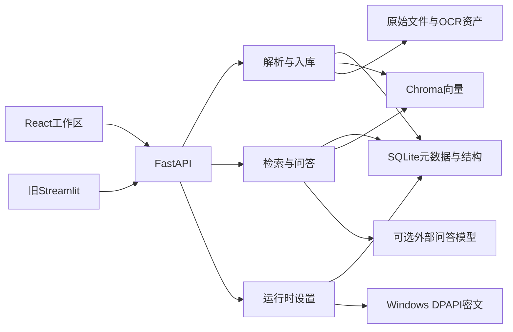

# DES-001 系统架构与存储边界

## 文档信息

- 文档ID：DES-001
- 文档类型：设计
- 状态：已完成
- 创建日期：2026-08-27
- 最后更新：2026-09-19
- 证据口径：当前文件静态核对；历史验证与待验证事项在正文区分，本次未重跑产品测试。
- 导航：[本类目录](./README.md) · [文档中心](../README.md)

## 1. 对应需求与设计目标

关系：总体实现[REQ-001 文档入库与可定位来源](../需求/REQ-001-文档入库与可定位来源.md)、[REQ-002 可解释检索与问答](../需求/REQ-002-可解释检索与问答.md)、[REQ-003 会话与知识库交互](../需求/REQ-003-会话与知识库交互.md)、[REQ-004 运行时设置与诊断](../需求/REQ-004-运行时设置与诊断.md)与[REQ-006 本地运行与数据安全](../需求/REQ-006-本地运行与数据安全.md)。目标是把原文存储、结构定位、检索、生成和运行配置分开，使数据问题能定位到具体层。

## 2. 系统架构与数据流

生产入口是[backend/main.py](../../backend/main.py)，React构建产物由FastAPI托管；没有构建产物时根路径返回JSON，API健康检查为GET /api/health。客户端只通过HTTP调用后端。

## 3. 存储契约与版本

| 载体 | 保存什么 | 不负责什么 |
|---|---|---|
| SQLite | documents、document_units、tags/document_tags、conversations/messages/chat_requests、message_traces、runtime_settings及history | 不存Embedding向量，不存普通设置明文Key |
| Chroma | chunk文本、向量和轻量定位metadata | 不做完整结构JSON主存储或权限系统 |
| uploads | 按document_id命名的原始文件 | 原文件名不是身份键 |
| OCR图像/视觉缓存 | 预览图片、按内容身份复用的识别文本 | 不代表原文人工审核 |
| DPAPI文件 | 当前Windows用户的LLM Key密文 | 不是跨主机通用明文备份 |

[metadata_schema.py](../../backend/services/metadata_schema.py)当前SCHEMA_VERSION=5：v2增加标签，v3增加Trace，v4增加运行时设置，v5增加成功助手消息的reasoning_content。来源引用状态保存在既有citations_json中，无需额外迁移。只对已版本化库显式迁移；未版本化旧库拒绝猜测迁移。

生产parser是structured-v2；Dataset v3的schema_version=3是第三个独立维度。本次核对代码版本，没有打开生产数据库确认其实际迁移状态。

## 4. 主要接口与模块拆分

上传/文档/标签 → [DEV-002 上传与索引生命周期](../开发/DEV-002-上传与索引生命周期.md)、[DEV-007 标签与知识库管理](../开发/DEV-007-标签与知识库管理.md)；聊天/会话/引用 → [DEV-005 会话流式问答](../开发/DEV-005-会话流式问答.md)、[DEV-006 来源引用与结构预览](../开发/DEV-006-来源引用与结构预览.md)；设置/Trace → [DEV-009 运行时设置与密钥](../开发/DEV-009-运行时设置与密钥.md)、[DEV-010 检索Trace与配置追溯](../开发/DEV-010-检索Trace与配置追溯.md)；静态托管与生命周期 → [DEV-012 服务托管与启动停止](../开发/DEV-012-服务托管与启动停止.md)。

路由定义见[routers](../../backend/routers/)。关键入口不是认证边界：当前无用户认证；CORS允许范围较宽，不能直接开放到不可信网络。

## 5. 方案取舍与异常处理

SQLite与Chroma分工便于本地维护，但没有跨库原子事务；上传用状态与补偿处理失败，重建使用独立目标目录。不会将“文件移动原子”扩大解释为整个入库事务原子。旧parser/page_store/Streamlit作为兼容实现保留，不作为主链路重新设计。

没有实现多副本配置同步、HA或远程生产部署；多进程并发与灾难恢复需独立设计和演练。关系：恢复验证见[TEST-009 本地运行与回滚验证](../测试/TEST-009-本地运行与回滚验证.md)，操作见[OPS-002重建](../运维/OPS-002-数据备份恢复与索引重建.md#rebuild)。

## 关联文档

- 关系：文档体系设计；[DES-008 文档治理架构](../设计/DES-008-文档治理架构.md)
- 关系：详细实现；[DEV-002 上传与索引生命周期](../开发/DEV-002-上传与索引生命周期.md)
- 关系：关联依赖；[DEV-005 会话流式问答](../开发/DEV-005-会话流式问答.md)
- 关系：关联依赖；[DEV-006 来源引用与结构预览](../开发/DEV-006-来源引用与结构预览.md)
- 关系：关联依赖；[DEV-007 标签与知识库管理](../开发/DEV-007-标签与知识库管理.md)
- 关系：关联依赖；[DEV-009 运行时设置与密钥](../开发/DEV-009-运行时设置与密钥.md)
- 关系：关联依赖；[DEV-010 检索Trace与配置追溯](../开发/DEV-010-检索Trace与配置追溯.md)
- 关系：详细实现；[DEV-012 服务托管与启动停止](../开发/DEV-012-服务托管与启动停止.md)
- 关系：运维；[OPS-002 数据备份恢复与索引重建](../运维/OPS-002-数据备份恢复与索引重建.md)
- 关系：来源需求；[REQ-001 文档入库与可定位来源](../需求/REQ-001-文档入库与可定位来源.md)
- 关系：来源需求；[REQ-002 可解释检索与问答](../需求/REQ-002-可解释检索与问答.md)
- 关系：来源需求；[REQ-003 会话与知识库交互](../需求/REQ-003-会话与知识库交互.md)
- 关系：来源需求；[REQ-004 运行时设置与诊断](../需求/REQ-004-运行时设置与诊断.md)
- 关系：来源需求；[REQ-006 本地运行与数据安全](../需求/REQ-006-本地运行与数据安全.md)
- 关系：关联依赖；[TEST-009 本地运行与回滚验证](../测试/TEST-009-本地运行与回滚验证.md)

## 变更记录

| 日期 | 内容 | 原因 |
|---|---|---|
| 2026-09-19 | 同步schema v5思考持久化与来源状态沿用JSON的边界 | 避免将代码版本与生产库实测状态混淆 |
| 2026-08-27 | 从当前代码与原资料整理，补充证据边界和双向链接 | 建立独立new_docs对照体系，保留原文件 |
