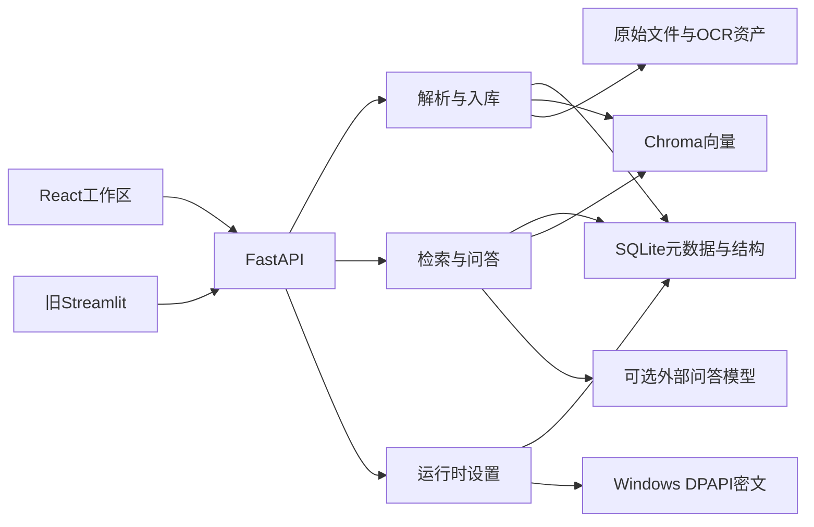

# DES-001 系统架构与存储边界

## 文档信息

- 文档ID：DES-001
- 文档类型：设计
- 状态：已完成
- 创建日期：2026-08-27
- 最后更新：2026-10-27
- 证据口径：既有架构及W1/W2历史保留；2026-10-24完成W3实例/启停/同源与基础维护，实际本机结果见TEST-009；无驱动Windows及W4—W5仍待完成。
- 导航：[本类目录](./README.md) · [文档中心](../README.md)

## 1. 对应需求与设计目标

关系：总体实现[REQ-001 文档入库与可定位来源](../需求/REQ-001-文档入库与可定位来源.md)、[REQ-002 可解释检索与问答](../需求/REQ-002-可解释检索与问答.md)、[REQ-003 会话与知识库交互](../需求/REQ-003-会话与知识库交互.md)、[REQ-004 运行时设置与诊断](../需求/REQ-004-运行时设置与诊断.md)与[REQ-006 本地运行与数据安全](../需求/REQ-006-本地运行与数据安全.md)。目标是把原文存储、结构定位、检索、生成和运行配置分开，使数据问题能定位到具体层。

## 2. 系统架构与数据流

生产入口是[backend/main.py](../../backend/main.py)，React构建产物由FastAPI托管；没有构建产物时根路径返回JSON，API健康检查为GET /api/health。客户端只通过HTTP调用后端。

## 3. 存储契约与版本

| 载体 | 保存什么 | 不负责什么 |
|---|---|---|
| SQLite | documents、document_units、tags/document_tags、conversations/messages/chat_requests、message_traces、runtime_settings及history | 不存Embedding向量，不存普通设置明文Key |
| Chroma | chunk文本、向量和轻量定位metadata | 不做完整结构JSON主存储或权限系统 |
| uploads | 按document_id命名的原始文件 | 原文件名不是身份键 |
| OCR图像/视觉缓存 | 预览图片、按内容身份复用的识别文本 | 不代表原文人工审核 |
| DPAPI文件 | 当前Windows用户的LLM Key密文 | 不是跨主机通用明文备份 |

[metadata_schema.py](../../backend/services/metadata_schema.py)当前SCHEMA_VERSION=6：v2增加标签，v3增加Trace，v4增加运行时设置，v5增加成功助手消息的reasoning_content，v6增加消息检索范围和覆盖请求暂存。来源引用状态保存在既有citations_json中，无需额外迁移。只对已版本化库显式迁移；未版本化旧库拒绝猜测迁移。

生产parser是structured-v2；Dataset v3的schema_version=3是第三个独立维度。本次核对代码版本，没有打开生产数据库确认其实际迁移状态。

## 4. 主要接口与模块拆分

上传/文档/标签 → [DEV-002 上传与索引生命周期](../开发/DEV-002-上传与索引生命周期.md)、[DEV-007 标签与知识库管理](../开发/DEV-007-标签与知识库管理.md)；聊天/会话/引用 → [DEV-005 会话流式问答](../开发/DEV-005-会话流式问答.md)、[DEV-006 来源引用与结构预览](../开发/DEV-006-来源引用与结构预览.md)；设置/Trace → [DEV-009 运行时设置与密钥](../开发/DEV-009-运行时设置与密钥.md)、[DEV-010 检索Trace与配置追溯](../开发/DEV-010-检索Trace与配置追溯.md)；静态托管与生命周期 → [DEV-012 服务托管与启动停止](../开发/DEV-012-服务托管与启动停止.md)。

路由定义见[routers](../../backend/routers/)。关键入口不是认证边界：当前无用户认证；CORS允许范围较宽，不能直接开放到不可信网络。

## 5. 方案取舍与异常处理

SQLite与Chroma分工便于本地维护，但没有跨库原子事务；上传用状态与补偿处理失败，重建使用独立目标目录。不会将“文件移动原子”扩大解释为整个入库事务原子。旧parser/page_store/Streamlit作为兼容实现保留，不作为主链路重新设计。

没有实现多副本配置同步、HA或远程生产部署；多进程并发与灾难恢复需独立设计和演练。关系：恢复验证见[TEST-009 本地运行与回滚验证](../测试/TEST-009-本地运行与回滚验证.md)，操作见[OPS-002重建](../运维/OPS-002-数据备份恢复与索引重建.md#rebuild)。

## 6. Windows单人本地发布边界（W1本机/W2/W3实现，W4—W5待完成）

依据[REQ-006 WR01—WR12](../需求/REQ-006-本地运行与数据安全.md#windows-release)，便携交付GPU优先/CPU备用，两者保留Hybrid与Reranker，用户自行配置API Key。W1本机、W2配置/新库首代及W3启停/本机访问/基础维护已实现并单列验证；W4正式包和W5完整验收仍待实施，不能把本文“已完成”当作完整发布包状态。详细范围见[OPS-005](../运维/OPS-005-Windows单人本地发布与初始化方案.md#w3-result)，自动维护工具后置。

| 边界 | 契约与阶段边界 |
|---|---|
| 发布与开发入口 | 发布包携带web/dist并由单个FastAPI进程托管；源码start.ps1继续构建React，开发者使用Node.js，普通用户不需要 |
| 运行时 | 优先装配一套可移动CUDA运行环境支持GPU与CPU，随包两份模型；无GPU/无驱动完整运行须单独验证，不能直接复制venv或让用户补依赖 |
| 配置 | 入口从自身位置确定便携根，跳过源码.env、旧路径/Key；在库导入前设置目录内资产/缓存/temp，页面覆盖规则保留；源码模式不变 |
| 资产 | 保留backend/与web/dist/同根，runtime/models/data/logs/cache/temp/state在解压根内；data保留工作空间身份/首发状态，state只保存当前运行记录；支持停服移动 |
| 模型与设备 | BGE large及reranker-v2-m3随包、固定revision/许可/hash；GPU实际校验，CPU经确认并关闭重排FP16，保持Hybrid/重排和候选参数，不借全局缓存补缺 |
| 新库首代 | Hybrid+bm25s_mmap；仅便携新工作空间非空ready语料首发，复用快照/摘要/源复核及原子发布；首发中断可恢复，已有库缺指针按故障处理，旧生产门禁不变 |
| oracle资源 | 便携构建基于当前快照生成确定性本地校验查询，复用rank_bm25对照；不依赖私人eval题库，不省略构建/mmap校验，源码120题合同保留 |
| 实例与网络 | 本机地址、单worker、工作空间独占锁、实例健康身份；限制Host/Origin与跨站写入，不引入账号体系 |
| 升级恢复 | 首版停服人工复制到新目录、业务导入前检查兼容；不支持则拒绝，schema变化不能只回滚代码；自动迁移/恢复工具后置 |
| 系统影响 | 无应用主动安装登记/持久环境变量/服务/自启/防火墙修改；文件和注册表写入跟踪覆盖子进程，系统/浏览器记录不清理且不宣称零痕迹 |
| 清理与移除 | 首版分类缓存清理及移除前准备；停服/外部备份后人工删整目录，明确含data；不越界或清理模型/OCR资产，重置与组件工具后置 |
| 移动与密钥 | 重新解析运行时/存储路径和实例身份，不继承旧PID；DPAPI跨机不可用时重配，个人数据仍可访问 |

完整目录、设备异常、首代及W1—W5拆分统一维护于[OPS-005](../运维/OPS-005-Windows单人本地发布与初始化方案.md#package)，代码映射见[DEV-012](../开发/DEV-012-服务托管与启动停止.md#windows-release)，首代设计见[DES-003](./DES-003-检索融合与上下文选择.md#portable-bootstrap)。W2由portable.py在业务导入前隔离配置并检查schema/模型/运行锁合同，工作空间首发日志和随机corpus ID随data保留。W3以双锁和实例/进程/资源身份确认所属后台，用绑定文件停止；同源检查只在便携模式启用，正常退出等待工作线程。缓存清理限已知文件，移除准备不自删，源码默认不变。实际CMD/HTTP/GPU及CPU重启见[W3记录](../测试/TEST-009-本地运行与回滚验证.md#w3-result)；无驱动新机器与W4—W5仍待完成，不是完整发布包。

2026-10-24 W4补充：独立构建目录按白名单输出内部预览ZIP，模型/运行时固定、前端按锁构建；便携启动先清理中断processing文档的部分向量/单元并标失败，保留上传文件，清理错误拒绝开放检索；退出各阶段错误可见。实现见[DEV-012 W4](../开发/DEV-012-服务托管与启动停止.md#w4-result)，验证边界见[TEST-009 W4](../测试/TEST-009-本地运行与回滚验证.md#w4-result)。不因此宣称原wheel/VC授权或W5完成。

2026-10-24便携托盘/端口：后台直接持有自动绑定的实际socket，实例端口统一用于同源约束/健康/网页/托盘。独立轻量Windows托盘通过原实例绑定的停止文件管理后台，不依赖HTTP停止接口；保留根/进程创建时间/nonce保护、单独托盘锁及确认强制停止。关系见[DEV-012](../开发/DEV-012-服务托管与启动停止.md#tray-auto-port)、[REQ-006](../需求/REQ-006-本地运行与数据安全.md#tray-auto-port)。

## 会话编辑、重新生成与范围快照（2026-10-26）

当前SQLite为v6，在v5上增加消息检索范围和覆盖请求暂存表，仍是顺序会话，无树状分支。源码沿用显式版本迁移；便携版仅放行同运行锁/模型下的v5→v6，并先保留SQLite备份，其他不兼容数据仍拒绝。细节见[DES-004](./DES-004-会话流式协议与来源预览.md#message-regeneration)、[DEV-005](../开发/DEV-005-会话流式问答.md#message-regeneration)，实际回归见[TEST-003](../测试/TEST-003-会话引用与流式协议.md#message-regeneration)。

## 离线应用更新（2026-10-27）

应用更新ZIP携带完整backend/launcher/React/入口和新资源清单，声明可支持的基包身份、固定运行锁及数据库迁移范围；模型、runtime和许可资产不变。检查/确认与执行分离，独立worker从冻结引擎运行，停服后备份程序和完整data，再进行可恢复替换。持久化活动记录阻止普通启动混合版本；候选验证期间暂停业务写请求。失败或中断按事务记录恢复程序，发生数据迁移时成套恢复data并保留候选现场；备份不完整或损坏时拒绝伪造恢复成功。详见[DEV-014](../开发/DEV-014-本地应用更新.md#transaction)及[TEST-010](../测试/TEST-010-本地应用更新验收.md)，需求见[REQ-006](../需求/REQ-006-本地运行与数据安全.md#offline-update)。

## 关联文档

- 关系：离线更新追踪；[TEST 本地应用更新验收](../测试/TEST-010-本地应用更新验收.md)。

- 关系：离线更新追踪；[DEV 本地应用更新](../开发/DEV-014-本地应用更新.md)。

- 关系：发布交付设计；[OPS-005 Windows单人本地发布与初始化方案](../运维/OPS-005-Windows单人本地发布与初始化方案.md)
- 关系：便携首代检索设计；[DES-003 检索融合与上下文选择](./DES-003-检索融合与上下文选择.md)

- 关系：文档体系设计；[DES-008 文档治理架构](../设计/DES-008-文档治理架构.md)
- 关系：详细实现；[DEV-002 上传与索引生命周期](../开发/DEV-002-上传与索引生命周期.md)
- 关系：关联依赖；[DEV-005 会话流式问答](../开发/DEV-005-会话流式问答.md)
- 关系：关联依赖；[DEV-006 来源引用与结构预览](../开发/DEV-006-来源引用与结构预览.md)
- 关系：关联依赖；[DEV-007 标签与知识库管理](../开发/DEV-007-标签与知识库管理.md)
- 关系：关联依赖；[DEV-009 运行时设置与密钥](../开发/DEV-009-运行时设置与密钥.md)
- 关系：关联依赖；[DEV-010 检索Trace与配置追溯](../开发/DEV-010-检索Trace与配置追溯.md)
- 关系：详细实现；[DEV-012 服务托管与启动停止](../开发/DEV-012-服务托管与启动停止.md)
- 关系：运维；[OPS-002 数据备份恢复与索引重建](../运维/OPS-002-数据备份恢复与索引重建.md)
- 关系：来源需求；[REQ-001 文档入库与可定位来源](../需求/REQ-001-文档入库与可定位来源.md)
- 关系：来源需求；[REQ-002 可解释检索与问答](../需求/REQ-002-可解释检索与问答.md)
- 关系：来源需求；[REQ-003 会话与知识库交互](../需求/REQ-003-会话与知识库交互.md)
- 关系：来源需求；[REQ-004 运行时设置与诊断](../需求/REQ-004-运行时设置与诊断.md)
- 关系：来源需求；[REQ-006 本地运行与数据安全](../需求/REQ-006-本地运行与数据安全.md)
- 关系：关联依赖；[TEST-009 本地运行与回滚验证](../测试/TEST-009-本地运行与回滚验证.md)

## 变更记录

| 日期 | 内容 | 原因 |
|---|---|---|
| 2026-10-27 | 增加保留数据的离线应用更新、完整事务备份与恢复边界 | 用户授权先实现本地更新包 |
| 2026-10-26 | 增加顺序会话编辑/重试、每轮范围快照及v6保留性迁移边界 | 用户确认先实施会话优化，范围可独立编辑 |
| 2026-10-24 | 增便携自动端口、原生托盘及绑定停止；记录CPU/GPU与图标验证和人工未验边界 | 用户部署实测建议；已有产品改动单独检查点，未修改系统设置 |
| 2026-10-24 | W4白名单构建/许可路径、便携关闭错误分阶段记录和中断入库清理边界 | 用户确认继续出包与恢复验证；不扩展为任意版本迁移或公开发行审核通过 |
| 2026-10-24 | W3实现实例/锁、文件停止、同源与保守维护，补实际CMD/HTTP验证边界 | 用户继续授权；四入口已可验证，W4—W5及无驱动Windows未完成 |
| 2026-10-24 | W2实现配置与工作空间兼容边界、首代日志/快照oracle，补实际隔离验收入口 | 用户授权继续部署；原架构、生产数据与源码默认保留，完整产品未交付 |
| 2026-10-03 | W1独立装配/锁及本机GPU/CPU移动实测完成；未改业务布局，跨机门禁仍待验收 | 用户授权W1并限定先验证本机，W2—W5尚未实现 |
| 2026-10-03 | 便携边界改为GPU优先/CPU备用、双模型/Hybrid、原布局、首代/oracle与人工维护 | 用户确认最小首版；能力均待实施，既有架构状态不变 |
| 2026-09-21 | 发布边界改为目录内自包含运行时/模型/data，补系统影响、移动和移除合同 | 同步用户确认的便携版，取消AppData默认与首次在线安装 |
| 2026-09-21 | 增加发布/源码双入口、独立用户根、固定模型revision及升级恢复边界 | 承接Windows单人本地交付要求；实现尚未开始 |
| 2026-09-19 | 同步schema v5思考持久化与来源状态沿用JSON的边界 | 避免将代码版本与生产库实测状态混淆 |
| 2026-08-27 | 从当前代码与原资料整理，补充证据边界和双向链接 | 建立独立new_docs对照体系，保留原文件 |
